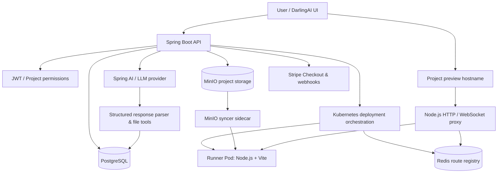

<div align="center">

# DarlingAI ✨
### From a prompt to a running web app

**An AI-powered application builder with Spring Boot, structured code generation, Kubernetes-backed development runners, and live React previews.**

     

*Built as a hands-on exploration of AI-assisted development, backend orchestration, and cloud-native application execution.*

</div>

> **Project status:** Functional development prototype. AI-generated React projects have been rendered through the Kubernetes preview proxy in local testing. This repository is **not yet a hardened multi-tenant production service**. Distributed event processing with Kafka and a complete CI/CD pipeline are planned, not implemented.

## Overview

DarlingAI lets users describe an application in natural language, generates and updates project files with an LLM, and provides a browser-based preview of the generated React application. Behind the interface, a Java backend coordinates persistence, object storage, Kubernetes runner Pods, dependency installation, Vite startup, and hostname-based routing.

Unlike a simple chat interface that only returns code snippets, DarlingAI connects **code generation to an executable development environment**.

## Features

| Area | Implemented capabilities |
| --- | --- |
| AI-assisted development | Prompt-driven code generation, structured LLM response parsing, file context, code-generation tools, and project-file updates |
| Projects | Project CRUD, generated file storage, file tree/content retrieval, and chat history |
| Authentication | User authentication and JWT-based security |
| Collaboration | Project membership and role/permission management |
| Subscriptions | Stripe Checkout integration, webhook handling, subscription and usage records |
| Preview orchestration | Kubernetes runner allocation, project file synchronization, dependency setup, and Vite startup |
| Preview networking | Redis-backed hostname-to-runner lookup, HTTP reverse proxy, and WebSocket forwarding for Vite HMR |
| Storage | PostgreSQL for application data; MinIO for project artifacts |

> A successful preview demonstrates that the infrastructure can serve a generated app; it does **not** guarantee every generated app will compile or behave correctly. Automated validation and repair are important upcoming improvements.

## Architecture



### Generation and preview lifecycle

1. A user creates a project and submits a prompt.
2. Spring Boot prepares context and calls the configured LLM through Spring AI.
3. The AI response is parsed into messages, file operations, and generated source files.
4. The backend persists project state and coordinates project-file synchronization through MinIO.
5. Deployment orchestration assigns an available Kubernetes runner and prepares its workspace.
6. The runner installs project dependencies as needed and starts a Vite development server.
7. A Redis entry maps the project's preview hostname to the runner endpoint.
8. The Node.js proxy forwards HTTP and WebSocket traffic to the runner, allowing the browser to load the generated application.

## Tech stack

| Layer | Technology |
| --- | --- |
| Backend | Java 25, Spring Boot 4.1.1, Spring Security, Spring Data JPA, Maven |
| AI | Spring AI 2.0.1, OpenAI-compatible provider configuration, custom response parser and generation tools |
| Database | PostgreSQL, Hibernate/JPA |
| Authentication | JWT |
| Object storage | MinIO |
| Deployment orchestration | Kubernetes, Fabric8 Kubernetes Client, Kind for local development |
| Runtime | Node.js 20 Alpine, React/Vite generated applications |
| Preview proxy | Node.js, `http-proxy`, `ioredis` |
| Cache / routing | Redis 7 |
| Billing | Stripe Java SDK and webhooks |
| Containers | Docker, custom syncer and proxy images |

## Repository structure

```text
DarlingAI/
├── src/main/java/com/CodingBrajmohan/DarlingAI/
│   ├── config/              # AI, Kubernetes, Redis, payment, storage configuration
│   ├── controller/          # Auth, billing, chat, files, projects, members, usage
│   ├── dto/                 # API request and response models
│   ├── entity/              # JPA domain models
│   ├── enums/               # Status, role, and permission definitions
│   ├── exception/           # API exception handling
│   ├── llm/                 # Response parsing, prompts, advisors, generation tools
│   ├── mapper/              # Entity / DTO mapping
│   ├── repository/          # Persistence repositories
│   ├── security/            # Authentication utilities
│   └── service/
│       ├── Interfaces/      # Service contracts
│       └── Implementation/  # Business logic and Kubernetes orchestration
├── src/main/resources/      # Spring application configuration
├── k8s/
│   ├── infra.yml            # Namespace, MinIO service, Redis
│   ├── runner-pods.yml      # Runner and syncer containers
│   ├── darling-ai-proxy.yml # Preview proxy deployment and service
│   └── policy.yml           # Network policy
├── proxy/                   # Node.js HTTP/WebSocket reverse proxy
├── syncer/                  # Custom MinIO client image
├── mvnw / mvnw.cmd
└── pom.xml
```

## Local development setup

**Prerequisites:** Java 25, Docker Desktop, `kubectl`, Kind, Maven wrapper support, PostgreSQL, MinIO, Redis, and an LLM API key. The Kubernetes instructions below target **Windows PowerShell with Docker Desktop + Kind**. This is a developer setup, not a one-command production deployment.

### 1. Clone and configure the backend

```powershell
git clone <YOUR_REPOSITORY_URL>
cd DarlingAI
```

Configure the backend's local environment using `src/main/resources/application.properties` and `application.yaml` as references. Supply **your own** database connection, LLM API key, JWT signing key, Stripe credentials, and MinIO credentials. Do not commit real credentials.

Relevant configuration names found in the source include:

```text
spring.datasource.url
spring.datasource.username
spring.datasource.password
spring.ai.openai.base-url
spring.ai.openai.api-key
spring.data.redis.host
spring.data.redis.port
jwt.secret-key
minio.url
minio.access-key
minio.secret-key
minio.project-bucket
stripe.api.secret
stripe.webhook.secret
```

**Security note:** The supplied project snapshot contains credential-bearing configuration and development credentials in Kubernetes YAML. Move secrets into environment variables or a secret manager, remove them from tracked files, and rotate any credentials that have already been shared or committed. The current YAML must be reviewed before publishing or deploying outside a trusted local environment.

### 2. Start supporting services

Start PostgreSQL, Redis, and MinIO with your own local configuration. The checked-in Kubernetes `infra.yml` exposes a MinIO `ExternalName` service pointing to `host.docker.internal:9000`, so MinIO must be reachable from the Kind node at that address for this development setup.

The backend configuration in the snapshot expects PostgreSQL on `localhost:9010`, Redis on `localhost:6379`, and MinIO on `localhost:9000`. Adapt these addresses to your environment; they are not portable defaults.

### 3. Create a Kind cluster

```powershell
kind create cluster --name darling-ai
kubectl cluster-info --context kind-darling-ai
```

### 4. Build and load the custom images

```powershell
docker build --platform linux/amd64 -t darling-ai-syncer:v1 ./syncer
docker build --platform linux/amd64 -t darling-ai-proxy:latest ./proxy

kind load docker-image darling-ai-syncer:v1 --name darling-ai
kind load docker-image darling-ai-proxy:latest --name darling-ai
```

**Important:** Kind nodes do not automatically see custom images stored in Docker Desktop. Image tags must match the Kubernetes manifests exactly. The proxy manifest uses `imagePullPolicy: IfNotPresent`, which is necessary for the locally loaded `latest` image.

### 5. Deploy the Kubernetes resources

```powershell
kubectl apply -f k8s/infra.yml
kubectl apply -f k8s/runner-pods.yml
kubectl apply -f k8s/darling-ai-proxy.yml
kubectl apply -f k8s/policy.yml

kubectl get pods -n darling-ai-apps
```

The expected development setup includes a Redis Pod, a proxy Pod, and two runner Pods. Each runner Pod has a Node.js container and a MinIO syncer sidecar; a healthy runner therefore shows `2/2` ready.

> **Before deploying:** Replace the hard-coded MinIO credentials in `k8s/runner-pods.yml` and review `k8s/policy.yml`. Network-policy enforcement depends on the cluster's CNI, and the supplied policy is not a comprehensive untrusted-code sandbox.

### 6. Run Spring Boot

```powershell
.\mvnw.cmd spring-boot:run
```

The snapshot configures the backend on `http://localhost:8080`.

### 7. Forward the preview proxy

```powershell
kubectl port-forward svc/darling-ai-proxy-svc 8090:80 -n darling-ai-apps
```

Leave this terminal open. The proxy routes requests by the **HTTP hostname**, not simply by `localhost`.

For a local project preview at `project-3.app.domain.com`, add this mapping to the Windows hosts file (`C:\Windows\System32\drivers\etc\hosts`) using an elevated editor:

```text
127.0.0.1 project-3.app.domain.com
```

Then visit:

```text
http://project-3.app.domain.com:8090
```

The hosts file does **not** support wildcard domains. Each local preview hostname requires its own mapping unless you configure a wildcard-capable DNS solution. `app.domain.com` is a development placeholder, not an automatically provisioned public domain.

## API entry points

The repository includes controllers for:

- `/api/projects` — project listing, creation, retrieval, updates, deletion
- `POST /api/projects/{id}/deploy` — request a project preview deployment
- Authentication, chat, project files, project members, billing, and usage — see the corresponding controller source for exact routes and authentication requirements

Do not assume these endpoints are public; protected operations require appropriate authentication and project access.

## Troubleshooting

| Symptom | Likely cause | Check |
| --- | --- | --- |
| `ImagePullBackOff` for syncer or proxy | Custom image not loaded into the active Kind cluster, mismatched tag, or pull policy | `kind load docker-image ... --name darling-ai`; inspect manifest image names |
| `Preview not found for localhost` | Proxy expects a project-specific `Host` header | `curl.exe -i -H "Host: project-3.app.domain.com" http://localhost:8090/` |
| `DNS_PROBE_FINISHED_NXDOMAIN` | Development preview hostname does not resolve on the host | Configure a hosts-file entry or local DNS |
| Vite returns HTTP 500 | Generated source may contain a syntax/import error | Inspect Vite logs in the assigned runner |
| `Failed to resolve import "daisyui/input"` | Invalid AI-generated import: daisyUI provides CSS classes, not that React module | Fix the generated component; don't blindly reinstall packages |
| Preview returns 502 | Proxy cannot connect to assigned runner/Vite | Check runner Pod, Vite process, and Redis route |
| Preview disappears after a period | Redis route TTL or runner lifecycle may have expired | Inspect route registration and deployment state |

Useful diagnostics:

```powershell
kubectl get pods -n darling-ai-apps
kubectl describe pod <POD_NAME> -n darling-ai-apps
kubectl logs deployment/darling-ai-proxy -n darling-ai-apps
kubectl exec -it <RUNNER_POD> -n darling-ai-apps -c runner -- sh
```

Inside the runner:

```sh
ls -la /app
cat /app/dev.log
```

`dev.log` exists only if the Vite launch command redirected logs to that file. The Pod's workspace uses `emptyDir` and is not durable across Pod replacement.

## Engineering considerations

This project is actively being improved. Important work before exposing it to untrusted users includes:

- Build/type-check validation and automated correction of AI-generated code
- Strong isolation for generated applications, with resource, network, and filesystem controls
- Reliable job state, deployment health checks, cleanup, and retry policies
- Secret management and removal of credentials from source control
- Load testing, observability, and recovery from runner/proxy/storage failures
- Safe multi-user concurrency and project lifecycle management

## Roadmap

- [x] Prompt-driven source generation and file persistence
- [x] Kubernetes-backed runner and Vite preview prototype
- [x] Redis-backed dynamic preview routing with WebSocket proxying
- [x] Stripe subscription/webhook integration
- [ ] Automated generated-code validation and repair
- [ ] Distributed service boundaries where independent scaling is justified
- [ ] Kafka-based event-driven workflows and background job processing
- [ ] Complete CI/CD pipeline with tests, image builds, scans, and deployment automation
- [ ] Production-grade sandboxing, observability, autoscaling, and recovery

## Why I built this

DarlingAI is an engineering project focused on the challenges behind AI-assisted software creation: turning model output into real files, executing generated applications in isolated development environments, routing previews dynamically, and coordinating storage, billing, and infrastructure. The goal is to evolve a working vertical slice into a reliable, distributed platform.

## Author

Developed by **Brajmohan**.

---

*DarlingAI is under active development. The architecture and setup described here reflect the provided repository snapshot and the local development workflow; they are not a claim of production readiness.*
